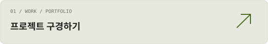
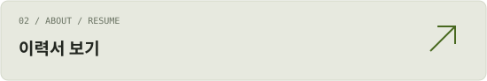
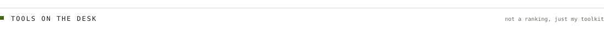
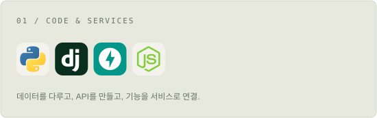
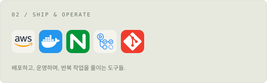
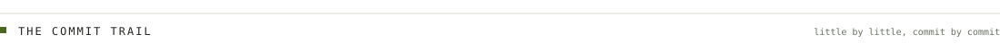
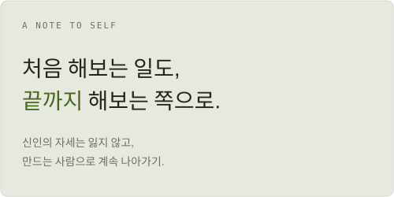
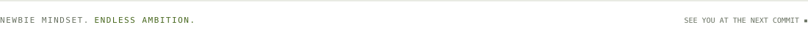

<picture><source media="(prefers-color-scheme: dark)" srcset="assets/workbench-dark.svg"></picture>

### 호기심 따라, 이것저것 알아가는 중.

아이디어를 떠올리고, 궁금한 건 질문하며 알아가는 걸 좋아합니다. 
AI와 함께 만들고, 막히면 파고들고, 그 과정에서 배웁니다.

CURRENTLY BUILDING / HTM · BACKEND · AI · OPERATIONS

<table><tr><td width="50%" valign="middle"><a href="https://newbission.github.io/portfolio/"><picture><source media="(prefers-color-scheme: dark)" srcset="assets/wb-portfolio-dark.svg"></picture></a></td><td width="50%" valign="middle"><a href="https://newbission.github.io/portfolio/#resume"><picture><source media="(prefers-color-scheme: dark)" srcset="assets/wb-resume-dark.svg"></picture></a></td></tr></table>

<picture><source media="(prefers-color-scheme: dark)" srcset="assets/wb-toolbox-dark.svg"></picture>

<table><tr><td width="50%" valign="middle"><picture><source media="(prefers-color-scheme: dark)" srcset="assets/wb-backend-dark.svg"></picture></td><td width="50%" valign="middle"><picture><source media="(prefers-color-scheme: dark)" srcset="assets/wb-infra-dark.svg"></picture></td></tr></table>

프로젝트에서 사용해 본 기술들입니다. 어떤 부분을 직접 맡았는지는 포트폴리오에서 확인할 수 있어요.

분야별 활용 경험 더 보기

- **배포·운영:** AWS EC2 · RDS · S3 · CloudFront · IAM · ALB, GitHub Actions, Nginx · Certbot
- **데이터·실시간 처리:** Kafka · Redis · RTSP
- **AI 기능 연동:** YOLO, OCR·음성 인식 모델 실행·연동, ChatGPT API
- **조회 도구·보고서:** C# · WinForms · HTML
- **개발 도구:** Claude 웹 · Claude Code

프로젝트에 따라 직접 구현한 부분과 AI를 활용한 범위가 다릅니다. 자세한 역할은 [포트폴리오](https://newbission.github.io/portfolio/)에 정리했습니다.

<picture><source media="(prefers-color-scheme: dark)" srcset="assets/wb-log-dark.svg"></picture>

<table><tr><td width="50%" valign="middle"><picture><source media="(prefers-color-scheme: dark)" srcset="https://github-profile-summary-cards.vercel.app/api/cards/profile-details?username=newbission&amp;theme=zenburn"></picture></td><td width="50%" valign="middle"><picture><source media="(prefers-color-scheme: dark)" srcset="assets/wb-note-dark.svg"></picture></td></tr></table>

<picture><source media="(prefers-color-scheme: dark)" srcset="assets/wb-footer-dark.svg"></picture>
